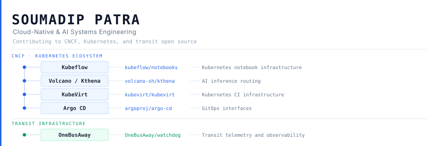

<picture>
  <source media="(prefers-color-scheme: dark)" srcset="assets/hero-dark.svg">
  
</picture>

<br>

Contributing to cloud-native infrastructure across the CNCF ecosystem and transit open source. Work spans Kubernetes notebook infrastructure, AI inference routing, GitOps interfaces, virtualization CI, and real-time transit telemetry. Personal engineering practice centers on distributed systems with Kafka, Kubernetes, and AI inference.

---

## Open Source Organizations

### [Kubeflow](https://github.com/kubeflow) · CNCF

**[`kubeflow/notebooks`](https://github.com/kubeflow/notebooks)** — Kubernetes notebook infrastructure

Kubernetes-native workspace management for ML practitioners. Work focuses on workspace lifecycle management, namespace-scoped deletion, and PVC access mode validation across multi-tenant deployments.

`TypeScript` `React` `Kubernetes`

---

### [Volcano / Kthena](https://github.com/volcano-sh) · CNCF

**[`volcano-sh/kthena`](https://github.com/volcano-sh/kthena)** — AI inference routing

Kubernetes-native AI inference serving platform routing requests across prefill and decode phases. Work focuses on error propagation and request-handling correctness in the inference router.

`Go` `AI Inference` `CNCF`

---

### [KubeVirt](https://github.com/kubevirt) · CNCF / Kubernetes

**[`kubevirt/kubevirt`](https://github.com/kubevirt/kubevirt)** — Kubernetes CI infrastructure

Kubernetes virtualization extension for running VMs natively alongside containers. Work focuses on CI test infrastructure and SIG naming conventions.

`Go` `CI Infrastructure` `Kubernetes`

---

### [Argo CD](https://github.com/argoproj) · CNCF

**[`argoproj/argo-cd`](https://github.com/argoproj/argo-cd)** — GitOps interfaces

GitOps continuous delivery tool for Kubernetes. Work in progress on pod log viewer UI components — highlight button state and stale-highlight reset behavior.

`TypeScript` `React` `GitOps`

---

### [OneBusAway](https://github.com/OneBusAway) · Transit Infrastructure

**[`OneBusAway/watchdog`](https://github.com/OneBusAway/watchdog)** — Transit telemetry and observability

Real-time transit data health monitoring, ingesting GTFS-Realtime feeds and reporting data quality via Prometheus metrics. Work focuses on vehicle attribution classification and metrics cardinality design.

`Go` `Prometheus` `GTFS-Realtime`

---

## Projects

### [AI-Driven Event Processing System](https://github.com/soumadipcodeEnthusiast/ai-driven-event-processing-system)

**Problem:** Distinguish anomalous events from healthy throughput in real time, forecast component failures before they breach thresholds, and generate actionable remediation playbooks — without coupling the ingestion path to the analysis paths.

**Architecture:** Four independent processing paths on a shared Kafka backbone.

```
Producers → Kafka: raw-events (6 partitions, keyed by source)
                │
    ┌───────────┼──────────────┬──────────────────────────┐
    │           │              │                          │
ingestion-    archival    diagnostic-service        forecasting-service
service       service     (anomaly scoring)         (TFT + Prometheus)
(Spring Boot) (→ S3)      per-stream EW baselines   p90 forecast vs threshold
    │                          │                          │
normalized-events         anomaly-audit            PredictiveAlerts
                               └──────────────────────────┘
                                        ↓
                               GraphRAG (Neo4j + Ollama)
                               2-hop dependency graph → ranked playbooks
                                        ↓
                               incident-playbooks topic

all services → Prometheus (15s scrape) → Grafana
```

**Architecture includes:** Kafka offset commits only after successful downstream write; exponentially-weighted anomaly baselines per (component, event-type) pair; GraphRAG cooldown per component to prevent LLM saturation; rule-based playbook fallback when Ollama is unavailable; Temporal Fusion Transformer with 10-minute lead-time forecasts; dead-letter topic for malformed events.

**Status:** Infrastructure complete. AWS EKS deployment via Terraform (`infra/terraform/eks.tf`). CI/CD pipeline via Jenkins (`Jenkinsfile`). 11 architecture decision records in `docs/adr/`.

`Java 17` `Spring Boot 3` `Python` `FastAPI` `Apache Kafka` `Neo4j` `PyTorch` `Ollama` `AWS EKS` `Terraform` `Prometheus` `Grafana` `Jenkins`

---

### [AKTE — Adaptive Knowledge & Teaching Engine](https://github.com/soumadipcodeEnthusiast/AKTE-Adaptive-AI-for-Personalized-Knowledge-Transformation)

**Outcome:** Top 4 of ~500 teams, AWS AI for Bharat Hackathon.

Two-phase LLM pipeline converting uploaded PDFs into personalized study companions via Amazon Bedrock. Phase one extracts structure and key concepts; phase two generates adaptive content calibrated to the learner. Team project.

`Amazon Bedrock` `RAG` `Python` `AWS`

---

### [FreeRTOS Scheduler](https://github.com/soumadipcodeEnthusiast/RTOSPROJECT)

Preemptive priority and round-robin scheduling on constrained embedded hardware. Explores context switching and real-time task management at the system level.

`C` `FreeRTOS`

---

### [AWS Serverless Event Pipeline](https://github.com/soumadipcodeEnthusiast/shopify-demo-with-aws-pipeline)

End-to-end serverless pipeline: Cognito authentication → SQS queuing → SNS fan-out → Step Functions orchestration → Lambda processing.

`AWS Lambda` `Step Functions` `SQS` `SNS` `Cognito` `JavaScript`

---

## Technical Profile

| Domain | Stack |
|---|---|
| Cloud Native | Kubernetes · Kubeflow · Volcano · Kthena · Argo CD · KubeVirt · Helm |
| Distributed Systems | Apache Kafka · Spring Boot · Redis · PostgreSQL · event-driven architecture |
| AI Engineering | Amazon Bedrock · RAG · GraphRAG · Temporal Fusion Transformer · Ollama |
| Observability | Prometheus · Grafana · SLO design · alert engineering · GTFS-RT telemetry |
| Cloud & Infrastructure | AWS (EKS · Lambda · S3 · DynamoDB · Cognito · SQS · SNS) · Terraform · Jenkins |
| Systems | C · FreeRTOS · scheduling algorithms |
| Languages | Go · Python · Java · TypeScript · C |

---

Currently active: working on [argoproj/argo-cd](https://github.com/argoproj/argo-cd) (pod log viewer, local branch) · investigating [kubeflow/trainer](https://github.com/kubeflow/trainer) · [spark-operator](https://github.com/kubeflow/spark-operator) · [volcano-sh/volcano](https://github.com/volcano-sh/volcano)
